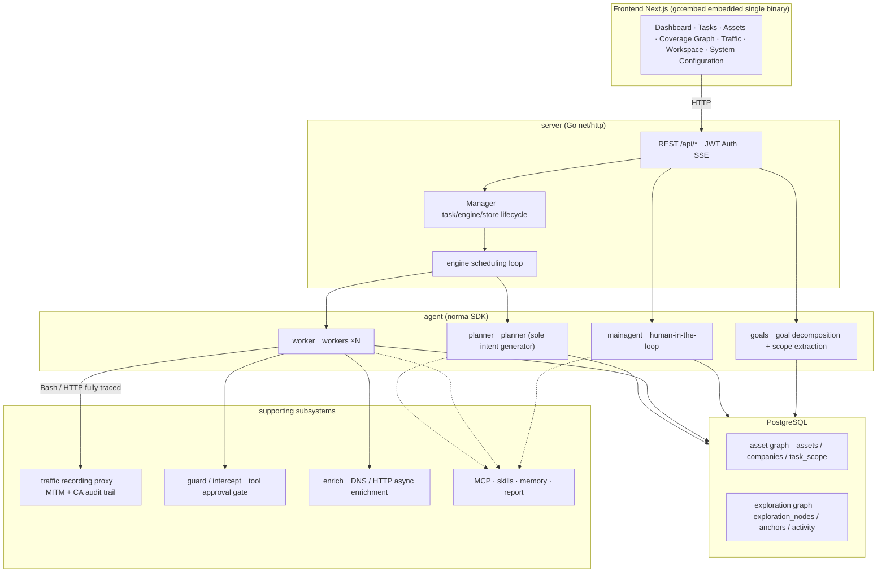
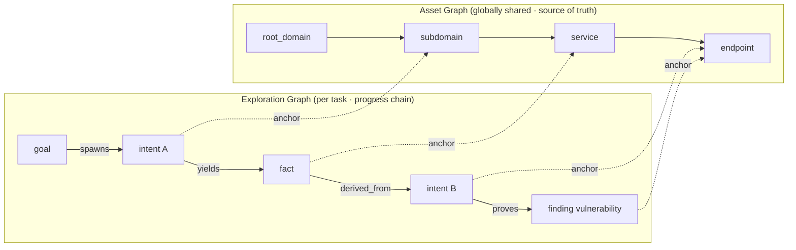
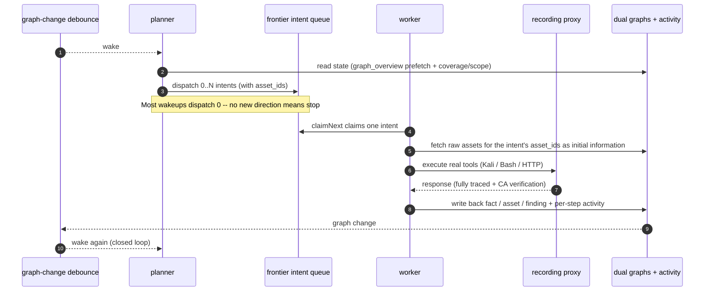
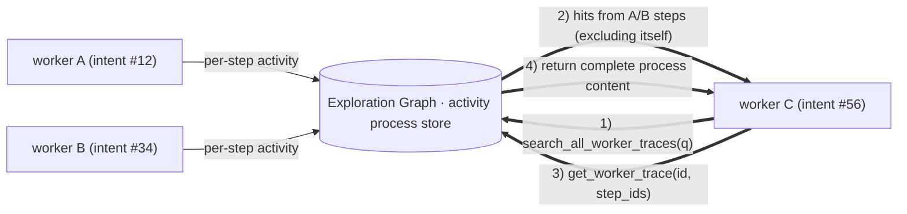
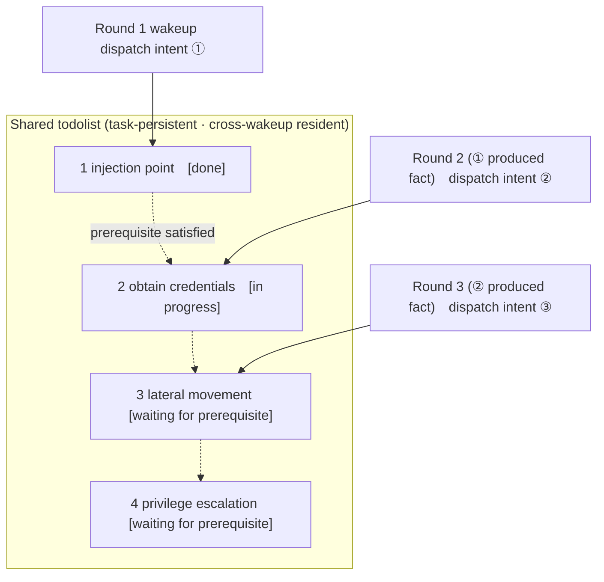

<div align="center">

# ARTEX
[简体中文](README.md) | **English** | [한국어](README.ko.md) | [日本語](README.ja.md)

Autonomous AI Penetration Testing System (Go backend + Next.js frontend)


🌐 **Online Demo**: [https://artex-demo.vercel.app/](https://artex-demo.vercel.app/)

</div>

---

## Screenshot Preview

> See the [online demo](https://artex-demo.vercel.app/) for the full interactive experience.

| Dashboard (overview / token usage / activity feed) | Task List |
| :---: | :---: |
|  |  |

| Task · Execution Process (sessions / tool calls) | Exploration Chain |
| :---: | :---: |
|  |  |

| Findings | Assets |
| :---: | :---: |
|  |  |

| Asset Coverage Graph (force-directed layout · tested highlights · node collapse/expand) |
| :---: |
|  |

| Traffic Recording | Human-in-the-Loop Chat |
| :---: | :---: |
|  |  |

| Agent Management | LLM Configuration |
| :---: | :---: |
|  |  |

| Intercept Approval | Backend Logs |
| :---: | :---: |
|  |  |


---

## Approval Record Details

The global "Approval Records" page, the in-task "Intercept Approval" view, and approval cards in chat all support expanding to view details. The display structure follows
[AegisHook's approval detail component](https://github.com/RuoJi6/AegisHook/blob/main/web/src/components/CallDetail.vue), while reusing ARTEX components and theme:


## Asset Sync (ScopeSentry)

Supports syncing asset data directly from [ScopeSentry](https://github.com/Autumn-27/ScopeSentry), avoiding duplicate collection:

- Enter the ScopeSentry address and API Key on the "**Asset Sync**" page to connect the data source;
- Select targets and asset types to sync by **project** or **task** (domains / subdomains / IPs / ports / sites / endpoints...);
- Import with one click, merge by company asset scope, and send the assets directly into ARTEX's asset graph for agent exploration.

---

## Installation

> Requires the **PostgreSQL** database; exploration requires configuring an **LLM** (`ANTHROPIC_API_KEY` or `OPENAI_API_KEY`, also configurable in the UI).

### Method 1: One-Click Install Script (Recommended)

```bash
git clone https://github.com/Autumn-27/ARTEX.git
cd ARTEX
./install.sh
```

The script will: detect / automatically install Docker → ask you to choose **① Full Docker** or **② Local build and run**:

- **① Full Docker**: enter a Postgres password (press Enter for a random one) → automatically write `.env` → `docker compose up -d`.
- **② Local run**: choose a database (connect to an existing one / start one with Docker) → generate `config.json` → compile the embedded single Go binary → start it.

After installation, open **http://localhost:8787** (on first entry, go to `/setup` to set the admin password).

### Method 2: Docker Compose (Manual)

```bash
git clone https://github.com/Autumn-27/ARTEX.git
cd ARTEX
cp .env.example .env          # Fill in POSTGRES_PASSWORD and optional ANTHROPIC_API_KEY
docker compose up -d          # Pull the autumn27/artex image + postgres
# → http://localhost:8787
```

The image already includes common tools (ripgrep/curl/vim/npm/nmap...); `./skills` and `./data` are persisted through bind mounts.

Remote MCP can be set to `http` (Streamable HTTP) or `sse` (legacy SSE) in system settings.
Legacy SSE services usually use `GET /sse` to establish the event stream, then receive JSON-RPC requests through the
`/message?sessionId=...` endpoint returned by the service; when configuring, set the URL to `/sse`, and set request headers as
`Authorization=Bearer <token>`.

### Method 3: Download a Prebuilt Binary (Releases)

Download the zip for your platform from [Releases](https://github.com/Autumn-27/ARTEX/releases). After extraction, you will get `artex` + `start.sh` (`start.bat` on Windows) + `skills/` + `config.example.json`:

```bash
cp config.example.json config.json   # Fill in the database connection
./start.sh                           # → http://localhost:8787
```

> Please start with `start.sh` / `start.bat`, not by running `./artex` directly. It is a supervisor script: after the program exits, it decides whether to restart it based on the exit code, and **the page's [one-click update](#method-1-in-page-one-click-update-recommended) relies on it to replace the binary**. If you run `./artex` directly, it will not be restarted after the update finishes.
> To keep it running in the background: `nohup ./start.sh >artex.log 2>&1 &`.

### Method 4: Build a Single Binary from Source

```bash
# 1) Static frontend export
cd web && npm ci && npm run build:static && cd ..
# 2) Copy into the embedded directory
cp -r web/out server/webui/dist
# 3) Build (-tags embedui is required to embed the frontend)
CGO_ENABLED=0 go build -tags embedui -o artex ./cmd/artex
./start.sh
```

### Method 5: Build Cross-Platform Release Archives

`build.sh` first builds and embeds the frontend, then uses the Go linker to strip debug information and compresses release files into zip archives. Release mode generates Linux amd64/arm64, macOS amd64/arm64, and Windows amd64 zip packages by default:

```bash
./build.sh --release
# Artifact: dist/artex-0.3.3-*.zip
```

UPX self-extracting binaries may be incompatible with some Linux kernels, virtualization environments, or security policies, so it is disabled by default. You can customize targets with `ARTEX_TARGETS`; if you have confirmed that the target runtime environment is compatible, explicitly pass `--upx` to further reduce binary size:

```bash
ARTEX_TARGETS=linux/amd64,windows/amd64 ./build.sh --release
./build.sh --target linux/amd64 --upx
```

---

## Updating and Upgrading

> Upgrades replace only the program and do not touch data: the Postgres data volume `pgdata`, `./data` (jwt.key / SQLite, etc.), and `./skills` are all preserved. **Database migrations do not need to be run manually** -- `artex` idempotently reruns `schema.sql` on every startup (including `ADD COLUMN` / `CREATE INDEX IF NOT EXISTS`), meaning "restart equals migrate." It is still recommended to back up `./data` and the database before upgrading.

<a id="method-1-in-page-one-click-update-recommended"></a>

### Method 1: In-Page One-Click Update (Recommended)

On the **System Configuration** page (sidebar "System Configuration" → `/system/settings`), the **Version and Updates** card lets you check for and install new versions directly, without logging in to the server.

After clicking "Update": download the release package for the current platform → compare the Release `SHA256SUMS` → smoke-test the new binary with `-h` → stage it as `artex.new` → the program exits, and `start.sh` / `start.bat` restarts it and completes the replacement. The page automatically waits for the new version to come online and then refreshes.

- **Failures will not leave a bad program behind**: if verification or smoke testing fails, the staged file is discarded and the current version keeps running; if the new version fails to start 3 consecutive times after replacement, it automatically rolls back to `artex.old` (the failed binary is kept as `artex.failed` for investigation).
- **Rollback is always available**: the previous version is kept as `artex.old`, and the card provides "Rollback to previous version." Note that the database structure will not roll back.
- **Updating interrupts running tasks** -- updating means restarting, so do it when the system is idle.
- **Development builds are not offered updates**: updates are disabled when the version is `dev` or when `git describe` includes a suffix, to avoid overwriting a locally debugged binary with an official release.
- **Under Docker, only the program is replaced, not the image**: toolchains such as playwright / nmap inside the image will not be upgraded, and after rebuilding the container with `docker compose up -d`, the version bundled in the image will be restored. To upgrade the image as well, still use `docker compose pull artex && docker compose up -d artex`.
- If accessing GitHub requires a proxy, configure the **global proxy** on the same page, and the update flow will use it. Updates download only from GitHub domains and enforce HTTPS.

### Method 2: One-Click Update Script

```bash
cd ARTEX
./update.sh
```

The script first optionally runs `git pull` to fetch the latest code, then asks you to choose **① Docker update** or **② Local build update** (matching `install.sh`):

- **① Docker**: optionally specify a target image tag (press Enter to keep `ARTEX_TAG` from `.env`, defaulting to `latest`) → `docker compose pull` → `docker compose up -d` (switch to the new image, restart, then automatically migrate).
- **② Local**: rebuild the static frontend artifact → recompile `./artex` (restart the process after completion for it to take effect).

### Method 3: Docker Compose (Manual)

```bash
cd ARTEX
git pull                       # Update compose / scripts (optional)
# Specify version: set ARTEX_TAG=v0.2.0 in .env; if unset, latest is used
docker compose pull artex
docker compose up -d artex     # Switch to the new image and restart → automatically migrate schema
docker image prune -f          # Clean up old images (optional)
```

### Method 4: Prebuilt Binary (Releases)

Download the new version zip from [Releases](https://github.com/Autumn-27/ARTEX/releases), stop the old process, then overwrite `artex` and `skills/` (keep your `config.json` and `data/`), and restart:

```bash
cp -r <extracted-directory>/skills ./ && cp <extracted-directory>/artex ./
./start.sh
```

### Method 5: Build from Source

```bash
git pull
cd web && npm ci && npm run build:static && cd ..
cp -r web/out server/webui/dist
CGO_ENABLED=0 go build -tags embedui -o artex ./cmd/artex
# Restart ./start.sh
```

---

## Configuration

**Database** (`config.json`, or override with the environment variable `ARTEX_PG_DSN`):

```json
{
  "database": {
    "host": "127.0.0.1", "port": 5432,
    "user": "artex", "password": "yourpass",
    "dbname": "artex", "sslmode": "disable"
  }
}
```

**LLM**: `export ANTHROPIC_API_KEY=sk-...` (or `OPENAI_API_KEY`), also configurable on the UI's "LLM Configuration" page.
Optional: `ARTEX_LLM_PROVIDER` / `ARTEX_LLM_MODEL` / `ARTEX_LLM_BASE_URL` / `ARTEX_LLM_PROXY`.

**Concurrency**: configure the number of work agents per task in "System Settings" (default 3).

**Common parameters**: `./start.sh -addr :8787 -proxy :8788` (`-addr` for frontend + API, `-proxy` for the traffic recording proxy). The startup script forwards parameters to `artex` as-is.

### Reverse Proxy Deployment (HTTPS / Only Expose 443)

The frontend and API/SSE are served by the same backend port (`:8787` by default). The real-time activity stream uses a **same-origin** address by default, so **there is no need to configure `NEXT_PUBLIC_SSE_BASE`**. Only expose 443 publicly and keep 8787 on the private network.

SSE is a long-lived connection with continuous pushes, so the reverse proxy **must disable buffering**; otherwise the browser can connect but will not receive events (the symptom is that the activity stream keeps spinning). Nginx example:

```nginx
server {
    listen 443 ssl;
    server_name your.domain.com;
    # ssl_certificate / ssl_certificate_key ...

    location / {
        proxy_pass http://127.0.0.1:8787;
        proxy_set_header Host $host;
        proxy_set_header X-Forwarded-Proto $scheme;

        # Key SSE settings: disable buffering, long timeout, HTTP/1.1
        proxy_buffering off;
        proxy_cache off;
        proxy_read_timeout 3600s;
        proxy_http_version 1.1;
        proxy_set_header Connection "";
    }
}
```

> Set `NEXT_PUBLIC_SSE_BASE` **at build time** only when SSE needs to use a different origin from the page (such as a separate subdomain). This variable is baked into the static package during `next build`; setting it later at container runtime has no effect.

---


## Development

### Manual Vulnerability Retesting

The "Retest" tab on the task details page lets you page through the task's vulnerabilities, view previous conclusions and evidence, and manually start a retest. After the retest starts, the current tab remains open and shows a spinning icon and "Retesting"; after confirming the fix, the vulnerability status is updated accordingly.

Click "Retest" in the action area of any vulnerability list row, or click "Start Retest" in the "Vulnerability Retest" section of the vulnerability details page. Fill in an optional fix version, test conditions, or constraints, and the system creates an independent retest Agent session while keeping the current page open after startup. The tiled list, task-grouped list, and asset views all support this entry point; while a retest is running, they show a spinning icon and "Retesting." Click through to the corresponding session when you need details, and after it ends the action returns to "Retest." Retesting does not require restarting the original scan task. Conclusions are categorized as "Still Reproducible," "Fixed," or "Unable to Confirm," and each conclusion, its evidence, and the session link are saved in the vulnerability details.

On first startup, the new backend preloads an editable "Vulnerability Retest" (`retester`) Agent. You can configure its prompt, LLM, run budget, and tools in Agent Management. By default it uses its bound LLM; if none is bound, it uses the globally active configuration. When a retest session completes successfully and the conclusion is "Fixed," the system automatically changes the vulnerability handling status to "Fixed"; running, failed, stopped, or other conclusions preserve the original status. Original evidence and reports are always preserved. You can also manually select "Fixed" from the status dropdown. If the same vulnerability is already being retested, the existing session is reused; after a stop, failure, or service restart, retesting can be started again.

In this version, history is viewed through vulnerability details and sessions. It is not yet included in vulnerability report exports or task archive packages, and it is not automatically associated with traffic packages. Demo mode only generates clearly labeled simulated records and does not request real targets.

### Local Run and Testing

```bash
./dev.sh    # Backend (:8787) + traffic proxy (:8788) + frontend next dev (:5173) → http://localhost:5173
```

- Backend: `go run ./cmd/artex` (without `-tags embedui`, the frontend is not embedded)
- Frontend: `cd web && npm run dev` (`/api` reverse-proxies to the backend, with hot reload)
- Tests: `go test ./...`
- Mock preview (no backend): `cd web && NEXT_PUBLIC_MOCK=1 npm run dev`

---

## System Technical Architecture

ARTEX is an **LLM multi-agent-driven autonomous penetration testing system**: a Go monolithic backend (embedding a Next.js frontend) + PostgreSQL. Agent capabilities are provided by the [`norma`](https://github.com/Autumn-27/norma) SDK (`agentcore` / `tool` / `permission` / `harness` / `memory` / `transcript`). Its core is a **dual-graph architecture**, plus two autonomy mechanisms around it: **process-level information exchange between workers** and a **planner multi-round shared todolist for stable attack chains**.

### Overall Layers



| Layer | Responsibility |
| --- | --- |
| **Frontend** | Next.js static export, embedded into the single binary with `go:embed`; visualizes tasks/assets/exploration chains/coverage graphs and human-in-the-loop chat |
| **server** | `net/http` routes + JWT auth + SSE; `Manager` manages the lifecycle of tasks, engines, and the DB store |
| **engine** | One `plannerLoop` + N worker goroutines per task; intent claiming, timeout/pause/drain |
| **agent** | goals / planner / worker / mainagent; `ToolSet` exposes the dual graphs as LLM tools |
| **db** | Postgres persistence for the dual graphs (pgx); schema is idempotently created on every startup via `go:embed` |
| **Support** | Recording MITM proxy, approval gate, async enrichment, MCP/skills/memory/report |

### Dual-Graph Architecture: Exploration Graph + Asset Graph

The system splits "**what the target is**" and "**how thoroughly it has been tested**" into two independent graphs that are connected by anchors:

- **Asset Graph (globally shared)**: the shared source of truth for assets across tasks. Nodes are `root_domain / subdomain / ip / service / app / endpoint`, owned by companies; parent-child relationships such as domain → subdomain → service → endpoint and deduplication keys are all computed by the program, while agents submit only raw information.
- **Exploration Graph (per task)**: the "thinking and progress" process for one task. Nodes are `goal` (goal) / `intent` (intent) / `fact` (fact) / `finding` (vulnerability) / `hint` (hint), linked by edges such as `spawns / derived_from / yields / proves` into a **lineage chain** that answers "which directions were derived from which facts, and what did they produce."
- **The two graphs are connected by anchors**: `exploration_anchors(node_id, asset_id)` anchors intents/facts/vulnerabilities to concrete assets. This lets you see which assets an "exploration direction" targeted, and conversely query which intents tested a given asset in this task and which facts were found. This also supports **asset test coverage** and the **asset coverage graph** (in-scope assets + tested highlights).



> Division of labor: the **planner** reads the exploration graph state, judges goals, and dispatches **intents** into the frontier only when there are new uncovered directions; a **worker** claims **one intent**, executes with real tools, writes new assets/facts/vulnerabilities back into both graphs, and then stops. The asset graph is shared facts, and the exploration graph is the per-task progress chain.

### Engine and Intent Lifecycle (One Exploration Loop)

The engine is an **event-driven** closed loop: graph changes wake the planner, the planner dispatches intents, workers claim intents, execute them, and write results back, and those writes trigger the next round -- until the goal is proven (`prove_goal`).



### Process-Level Information Exchange Between Workers

In a deep exploration, many valuable observations (an error message, a response snippet, a hidden parameter) appear in one worker's **execution process**, but may not yet have been written as formal facts. To avoid duplicate work and let workers along the chain stand on each other's shoulders, workers can **retrieve other workers' processes across work items**:

- `search_all_worker_traces(q)`: searches **the execution processes of other work items in this task** by keyword (automatically excluding the current intent's own steps), with hits carrying `intent_id`;
- `list_worker_traces` / `get_worker_trace(intent_id, step_ids=[...])`: first see which work items have run, then fetch the complete content of specific steps from a work item for detailed exchange.

This means that even when the exploration graph does not yet contain the corresponding fact, later workers can reuse observations from others' processes -- **information flows between workers at the "execution process" granularity**, while boundaries stay unchanged (each worker still only performs the one intent it claimed).



### Planner Multi-Round Shared Todolist → Stable Attack Chains

Real attack chains are often **multi-step sequences with dependencies** (for example: find an injection point → obtain credentials → lateral movement → privilege escalation). Dispatching all of these in parallel at once would only create chaos. The planner therefore maintains a **task-persistent, cross-wakeup shared planning todolist**:

- The planner is event-driven -- it wakes whenever the graph changes, but **each wakeup is a fresh session**; the shared todolist lets it **record a serial exploitation chain once**, then **dispatch intents step by step according to dependencies** over later rounds, instead of expanding the entire chain upfront in one round;
- Each round dispatches intents only for the next steps whose "prerequisite steps are complete and dependent facts exist," and updates the list as progress is made (marking steps satisfied by facts as complete).



As a result, attack chains can still **advance stably, without repetition or disorder**, even in an "event-driven + stateless session" environment -- this is the key to ARTEX autonomously completing multi-step exploitation chains.

---

## Community

Scan the QR code to follow the **SecSentry** WeChat official account, then send it a private message to join the group.

<div align="center">


</div>

---
## References

https://github.com/oritera/Cairn


## License and Disclaimer

### Open Source License

This project is licensed under the **GNU Affero General Public License v3.0 (AGPL-3.0)**. See the [LICENSE](LICENSE) file in the repository root for the full terms.

This means anyone may freely use, modify, and distribute this project, but **derivative works must also be open-sourced under AGPL-3.0**; in particular, **if you modify this project and provide it to users over a network (for example, by deploying it as an online service), you must also make the corresponding complete source code available to those users**.

> ⚠️ **Important Notice**: The open source license itself does not restrict the purposes for which the software may be used. The following "Usage Restrictions" and "Disclaimer" are additional agreements and solemn statements from the author to users. Please comply with them.

**ARTEX is only for personal learning, code research, and local technical verification. It must not be used to conduct actual testing against any online system or website.**

### Permitted Scope of Use

- It may only be used for **reading, learning from, and researching this project's source code**, and for technical principle verification in a **local isolated environment**;
- It is suitable for non-offensive purposes such as personal learning, academic research, and code review.

### Prohibited Conduct

- **It is strictly prohibited to use this tool to scan, probe, exploit, or attack any website, online service, or networked system** (regardless of whether authorization has been obtained or whether it is your own asset);
- It is strictly prohibited to use this tool for any actual penetration testing, offensive/defensive exercise, or production environment;
- It is strictly prohibited to use this tool for illegal intrusion, data theft, extortion, denial of service, or any destructive or criminal activity;
- It is strictly prohibited to use this tool for conduct that violates the laws and regulations of the country/region where you are located.

### Compliance Responsibility

Users must independently comply with all laws and regulations in their country/region regarding cybersecurity, data protection, and computer crime (in mainland China, including but not limited to the Cybersecurity Law, Data Security Law, Personal Information Protection Law, and related judicial interpretations). **All legal responsibilities and consequences arising from the use of this tool are borne solely by the user.**

### Disclaimer

This project is provided "as is" (AS IS), without any express or implied warranty. The author and contributors are not responsible for any direct or indirect losses, data loss, system damage, or legal disputes caused by using this tool (regardless of whether it is used properly). **By downloading, installing, or using this project, you indicate that you have read, understood, and agreed to all of the above terms.**
