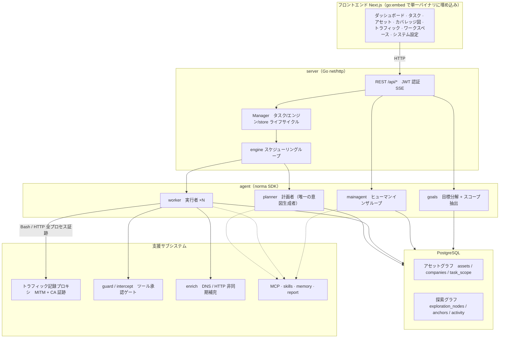
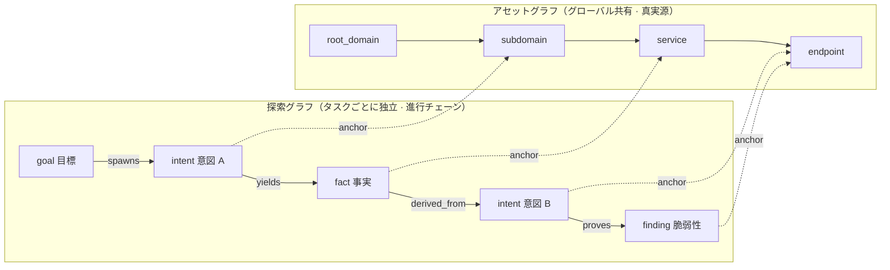
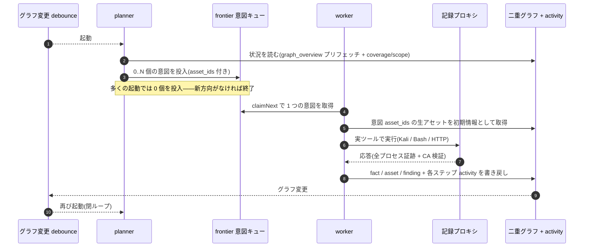
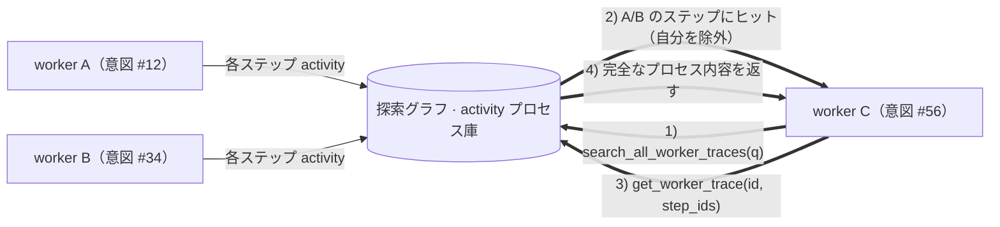
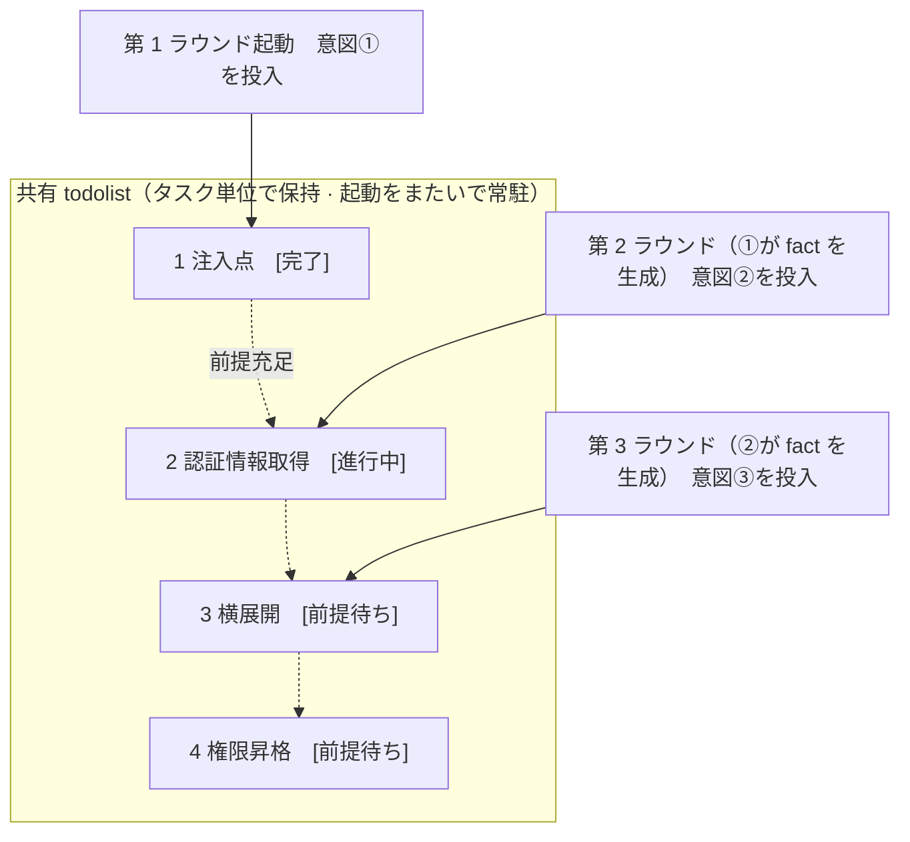

<div align="center">

# ARTEX

[简体中文](README.md) | [English](README.en.md) | [한국어](README.ko.md) | **日本語**

AI 自律型ペネトレーションテストシステム（Go バックエンド + Next.js フロントエンド）


🌐 **オンライン Demo**： [https://artex-demo.vercel.app/](https://artex-demo.vercel.app/)

</div>

---

## スクリーンショットプレビュー

> 完全なインタラクションは[オンライン Demo](https://artex-demo.vercel.app/)をご覧ください。

| ダッシュボード（概要 / Token 消費 / アクティビティストリーム） | タスクリスト |
| :---: | :---: |
|  |  |

| タスク · 実行プロセス（セッション / ツール呼び出し） | 探索チェーン |
| :---: | :---: |
|  |  |

| 発見事項 | アセット |
| :---: | :---: |
|  |  |

| アセットカバレッジ図（力指向レイアウト · テスト済みハイライト · ノードの折りたたみ/展開） |
| :---: |
|  |

| トラフィック記録 | ヒューマンインザループ対話 |
| :---: | :---: |
|  |  |

| Agent 管理 | LLM 設定 |
| :---: | :---: |
|  |  |

| インターセプト承認 | バックエンドログ |
| :---: | :---: |
|  |  |


---

## 承認記録の詳細

グローバルの「承認記録」、タスク内の「インターセプト承認」、および対話内の承認カードはいずれも展開して詳細を確認できます。表示構造は
[AegisHook の承認詳細コンポーネント](https://github.com/RuoJi6/AegisHook/blob/main/web/src/components/CallDetail.vue)を参考にし、ARTEX のコンポーネントとテーマを踏襲しています。


## アセット同期（ScopeSentry）

[ScopeSentry](https://github.com/Autumn-27/ScopeSentry) からアセットデータを直接同期でき、重複した収集作業を省けます。

- 「**アセット同期**」ページで ScopeSentry のアドレスと API Key を入力し、データソースを接続します。
- **プロジェクト**または**タスク**の単位で、同期先とアセット種別（ドメイン / サブドメイン / IP / ポート / サイト / エンドポイント…）を選択します。
- ワンクリックでインポートし、会社のアセット範囲ごとに統合して、agent が探索に使える ARTEX のアセットグラフへ直接取り込みます。

---

## インストール

> データベース **PostgreSQL** が必要です。探索には **LLM** の設定が必要です（`ANTHROPIC_API_KEY` または `OPENAI_API_KEY`。UI からも設定できます）。

### 方法 1：ワンクリックインストールスクリプト（推奨）

```bash
git clone https://github.com/Autumn-27/ARTEX.git
cd ARTEX
./install.sh
```

スクリプトは Docker を検出 / 自動インストールし、**① すべて Docker** または **② ローカルでビルドして実行** を選ばせます。

- **① すべて Docker**：Postgres パスワードを入力（Enter でランダム生成可）→ `.env` を自動作成 → `docker compose up -d`。
- **② ローカル実行**：データベースを選択（既存へ接続 / Docker で起動）→ `config.json` を生成 → `go` で埋め込み単一バイナリをビルド → 起動。

インストール後、**http://localhost:8787** を開きます（初回は `/setup` で管理者パスワードを設定します）。

### 方法 2：Docker Compose（手動）

```bash
git clone https://github.com/Autumn-27/ARTEX.git
cd ARTEX
cp .env.example .env          # POSTGRES_PASSWORD と任意の ANTHROPIC_API_KEY を入力
docker compose up -d          # autumn27/artex イメージ + postgres を取得
# → http://localhost:8787
```

イメージには一般的なツール（ripgrep/curl/vim/npm/nmap…）が含まれています。`./skills` と `./data` は bind mount で永続化されます。

リモート MCP はシステム設定で `http`（Streamable HTTP）または `sse`（旧版 SSE）を選択できます。
旧版 SSE サービスでは通常、`GET /sse` でイベントストリームを確立し、サービスが返す
`/message?sessionId=...` で JSON-RPC リクエストを受け取ります。設定時は URL に `/sse` を入力し、リクエストヘッダーは
`Authorization=Bearer <token>` の形式で入力します。

### 方法 3：プリビルドバイナリをダウンロード（Releases）

[Releases](https://github.com/Autumn-27/ARTEX/releases) から対応プラットフォームの zip をダウンロードします。展開すると `artex` + `start.sh`（Windows は `start.bat`）+ `skills/` + `config.example.json` が得られます。

```bash
cp config.example.json config.json   # database 接続を入力
./start.sh                           # → http://localhost:8787
```

> 直接 `./artex` を実行せず、`start.sh` / `start.bat` で起動してください。これはデーモンスクリプトで、プログラム終了後に終了コードに応じて再起動するかを決めます。**ページ上の[ワンクリック更新](#method-1-ui-one-click-update-recommended)は、この仕組みによって入れ替えを完了します**。`./artex` を直接実行すると、更新後に再起動されません。
> バックグラウンド常駐：`nohup ./start.sh >artex.log 2>&1 &`。

### 方法 4：ソースから単一バイナリをビルド

```bash
# 1) フロントエンドを静的エクスポート
cd web && npm ci && npm run build:static && cd ..
# 2) 埋め込みディレクトリへコピー
cp -r web/out server/webui/dist
# 3) ビルド（-tags embedui でフロントエンドを埋め込み）
CGO_ENABLED=0 go build -tags embedui -o artex ./cmd/artex
./start.sh
```

### 方法 5：クロスプラットフォーム Release 圧縮パッケージをビルド

`build.sh` は先にフロントエンドをビルドして埋め込み、次に Go linker でデバッグ情報を除去し、配布ファイルを zip として圧縮します。Release モードではデフォルトで Linux amd64/arm64、macOS amd64/arm64、Windows amd64 の zip パッケージを生成します。

```bash
./build.sh --release
# 生成物：dist/artex-0.3.3-*.zip
```

UPX 自己解凍バイナリは一部の Linux カーネル、仮想化環境、またはセキュリティポリシーと互換性がない可能性があるため、デフォルトでは有効化されません。`ARTEX_TARGETS` でターゲットをカスタマイズできます。対象実行環境に互換性があると確認できる場合は、`--upx` を明示的に渡してバイナリをさらに小さくできます。

```bash
ARTEX_TARGETS=linux/amd64,windows/amd64 ./build.sh --release
./build.sh --target linux/amd64 --upx
```

---

## 更新とアップグレード

> アップグレードではプログラムのみを入れ替え、データは変更しません。Postgres データボリューム `pgdata`、`./data`（jwt.key / SQLite など）、`./skills` はすべて保持されます。**データベース移行を手動で実行する必要はありません**。`artex` は起動のたびに `schema.sql`（`ADD COLUMN` / `CREATE INDEX IF NOT EXISTS` を含む）を冪等に再実行します。つまり「再起動すれば移行」です。アップグレード前には、引き続き `./data` とデータベースのバックアップを推奨します。

<a id="method-1-ui-one-click-update-recommended"></a>
### 方法 1：画面からのワンクリック更新（推奨）

**システム設定**ページ（サイドバー「システム設定」→ `/system/settings`）の**バージョンと更新**カードで、サーバーへログインせずに新バージョンを直接確認・インストールできます。

「更新」をクリックすると、現在のプラットフォーム向けリリースパッケージをダウンロード → Release の `SHA256SUMS` と照合 → `-h` で新バイナリをスモークテスト → `artex.new` として一時保存 → プログラムが終了し、`start.sh` / `start.bat` が再起動して入れ替えを完了します。ページは新バージョンがオンラインになるまで自動で待機し、その後リフレッシュします。

- **失敗しても壊れたプログラムは残りません**：検証またはスモークテストに失敗した場合、一時ファイルを破棄して現行バージョンを継続します。入れ替え後の新バージョンが 3 回連続で起動に失敗した場合は、自動で `artex.old` にロールバックします（失敗したものは調査用に `artex.failed` として残ります）。
- **いつでもロールバック可能**：直前のバージョンは `artex.old` として保持され、カード上に「前のバージョンへロールバック」があります。データベース構造はロールバックされない点に注意してください。
- **更新は実行中のタスクを中断します**。更新は再起動を伴うため、空き時間に実行してください。
- **開発ビルドでは更新できません**：バージョン番号が `dev`、または `git describe` にサフィックスが付く場合は無効化されます。正式版がローカルデバッグ用バイナリを上書きするのを避けるためです。
- **Docker ではプログラムのみを入れ替え、イメージは入れ替えません**：イメージ内の playwright / nmap などのツールチェーンは追従してアップグレードされず、`docker compose up -d` でコンテナを再作成するとイメージ同梱版に戻ります。イメージも含めてアップグレードする場合は、引き続き `docker compose pull artex && docker compose up -d artex` を使用してください。
- GitHub へのアクセスにプロキシが必要な場合は、同じページで**グローバルプロキシ**を設定すれば、更新経路にも適用されます。更新は GitHub ドメインからのみダウンロードし、HTTPS を強制します。

### 方法 2：ワンクリック更新スクリプト

```bash
cd ARTEX
./update.sh
```

スクリプトは任意で `git pull` により最新コードを取得し、その後 **① Docker 更新** または **② ローカルビルド更新**（`install.sh` に対応）を選ばせます。

- **① Docker**：対象イメージ tag を指定できます（Enter で `.env` の `ARTEX_TAG` を継続利用、未指定なら `latest`）→ `docker compose pull` → `docker compose up -d`（新しいイメージへの入れ替えと再起動で自動移行）。
- **② ローカル**：フロントエンド静的生成物を再ビルド → `./artex` を再コンパイル（完了後、プロセス再起動で反映）。

### 方法 3：Docker Compose（手動）

```bash
cd ARTEX
git pull                       # compose / スクリプトを更新（任意）
# バージョン指定：.env で ARTEX_TAG=v0.2.0 を設定。未設定なら latest
docker compose pull artex
docker compose up -d artex     # 新しいイメージへ入れ替えて再起動 → schema を自動移行
docker image prune -f          # 古いイメージを削除（任意）
```

### 方法 4：プリビルドバイナリ（Releases）

[Releases](https://github.com/Autumn-27/ARTEX/releases) から新バージョンの zip をダウンロードし、古いプロセスを停止してから `artex` と `skills/` を上書きします（`config.json` と `data/` は保持）。その後再起動します。

```bash
cp -r <展開ディレクトリ>/skills ./ && cp <展開ディレクトリ>/artex ./
./start.sh
```

### 方法 5：ソースからビルド

```bash
git pull
cd web && npm ci && npm run build:static && cd ..
cp -r web/out server/webui/dist
CGO_ENABLED=0 go build -tags embedui -o artex ./cmd/artex
# ./start.sh を再起動
```

---

## 設定

**データベース**（`config.json`、または環境変数 `ARTEX_PG_DSN` で上書き）：

```json
{
  "database": {
    "host": "127.0.0.1", "port": 5432,
    "user": "artex", "password": "yourpass",
    "dbname": "artex", "sslmode": "disable"
  }
}
```

**LLM**：`export ANTHROPIC_API_KEY=sk-...`（または `OPENAI_API_KEY`）。UI の「LLM 設定」ページからも入力できます。
任意：`ARTEX_LLM_PROVIDER` / `ARTEX_LLM_MODEL` / `ARTEX_LLM_BASE_URL` / `ARTEX_LLM_PROXY`。

**並行数**：各タスクの work agent 数は「システム設定」で設定します（デフォルト 3）。

**よく使うパラメータ**：`./start.sh -addr :8787 -proxy :8788`（`-addr` はフロントエンド + API、`-proxy` はトラフィック記録プロキシ）。起動スクリプトはパラメータをそのまま `artex` に渡します。

### リバースプロキシデプロイ（HTTPS / 443 のみ公開）

フロントエンドと API/SSE はいずれも同じバックエンドポート（デフォルト `:8787`）から提供されます。リアルタイムアクティビティストリームはデフォルトで**同一オリジン**のアドレスを使うため、**`NEXT_PUBLIC_SSE_BASE` を設定する必要はありません**。公開側は 443 のみを開放し、8787 は内部ネットワークに残せます。

SSE は長時間接続 + 継続的な push であるため、リバースプロキシでは**必ずバッファリングを無効化**してください。そうしないと、ブラウザは接続できてもイベントを受信できません（アクティビティストリームが回り続けるように見えます）。Nginx 例：

```nginx
server {
    listen 443 ssl;
    server_name your.domain.com;
    # ssl_certificate / ssl_certificate_key ...

    location / {
        proxy_pass http://127.0.0.1:8787;
        proxy_set_header Host $host;
        proxy_set_header X-Forwarded-Proto $scheme;

        # SSE の重要項目：バッファリング無効化、長いタイムアウト、HTTP/1.1
        proxy_buffering off;
        proxy_cache off;
        proxy_read_timeout 3600s;
        proxy_http_version 1.1;
        proxy_set_header Connection "";
    }
}
```

> SSE をページとは異なるオリジン（例：独立サブドメイン）で扱う必要がある場合にのみ、**ビルド時**に `NEXT_PUBLIC_SSE_BASE` を設定してください（この変数は `next build` 時に静的パッケージへ固定されるため、コンテナ実行時に設定しても無効です）。

---


## 開発

### 手動での脆弱性再テスト

タスク詳細の「再テスト」タブでは、このタスクの脆弱性をページングで選択し、過去の結論と証拠を確認し、手動で再テストを開始できます。開始後は現在のタブを維持し、スピナーアイコンと「再テスト中」を表示します。修正確認後、脆弱性ステータスを同期更新します。

脆弱性リストの各行の操作エリアで「再テスト」をクリックするか、脆弱性詳細の「脆弱性再テスト」エリアで「再テストを開始」をクリックし、任意の修正バージョン、テスト条件、または制限を入力します。システムは独立した再テスト Agent セッションを作成し、開始後も現在のページを維持します。リストのタイル表示、タスク別グループ表示、アセットビューはいずれもこの入口をサポートします。再テスト実行中はスピナーアイコンと「再テスト中」が表示され、確認が必要な場合はクリックして対応するセッションへ移動できます。終了後は「再テスト」に戻ります。再テストでは元のスキャンタスクを再起動する必要はありません。結論は「再現可能」「修正済み」「確認不能」に分かれ、各回の結論、証拠、セッションリンクは脆弱性詳細に保存されます。

新しいバックエンドは初回起動時に、編集可能な「脆弱性再テスト」（`retester`）Agent をプリセットします。Agent 管理でプロンプト、LLM、実行予算、ツールを設定できます。デフォルトではバインドされた LLM を使用し、未バインドの場合はグローバルのアクティブ設定を使用します。再テストセッションが正常に完了し、結論が「修正済み」の場合、システムは脆弱性の対応ステータスを自動的に「修正済み」へ変更します。実行中、失敗、停止、またはその他の結論では元のステータスを保持します。元の証拠とレポートは常に保持されます。ステータスのドロップダウンメニューから手動で「修正済み」を選ぶこともできます。同じ脆弱性が再テスト中の場合は既存セッションを再利用し、停止、失敗、またはサービス再起動後には再度開始できます。

このバージョンの履歴記録は脆弱性詳細とセッションから確認できますが、現時点では脆弱性レポートのエクスポートやタスクアーカイブパッケージには含まれず、トラフィックパッケージとも自動関連付けされません。デモモードでは、明確にラベル付けされた模擬記録のみを生成し、実際のターゲットへはリクエストしません。

### ローカル実行とテスト

```bash
./dev.sh    # バックエンド(:8787) + トラフィックプロキシ(:8788) + フロントエンド next dev(:5173) → http://localhost:5173
```

- バックエンド：`go run ./cmd/artex`（`-tags embedui` なしではフロントエンドを埋め込みません）
- フロントエンド：`cd web && npm run dev`（`/api` はバックエンドへリバースプロキシされ、ホットリロードあり）
- テスト：`go test ./...`
- Mock プレビュー（バックエンドなし）：`cd web && NEXT_PUBLIC_MOCK=1 npm run dev`

---

## システム技術アーキテクチャ

ARTEX は **LLM マルチ agent 駆動の自律型ペネトレーションシステム**です。Go 単体バックエンド（Next.js フロントエンドを埋め込み）+ PostgreSQL で構成され、agent 能力は [`norma`](https://github.com/Autumn-27/norma) SDK（`agentcore` / `tool` / `permission` / `harness` / `memory` / `transcript`）により提供されます。中核は**二重グラフアーキテクチャ**と、それを取り巻く 2 つの自律性メカニズム、すなわち **worker 間のプロセスレベル情報交換**と **planner の複数ラウンド共有 todolist による安定した攻撃チェーン**です。

### 全体レイヤー



| レイヤー | 役割 |
| --- | --- |
| **フロントエンド** | Next.js 静的エクスポートを `go:embed` で単一バイナリへ埋め込み。タスク/アセット/探索チェーン/カバレッジ図、ヒューマンインザループ対話を可視化 |
| **server** | `net/http` ルーティング + JWT 認証 + SSE。`Manager` がタスク、エンジン、DB store のライフサイクルを管理 |
| **engine** | タスクごとに 1 つの `plannerLoop` + N 個の worker goroutine。意図の取得、タイムアウト/一時停止/drain |
| **agent** | goals / planner / worker / mainagent。`ToolSet` が二重グラフを LLM ツールとして公開 |
| **db** | 二重グラフの Postgres 永続化（pgx）。schema は `go:embed` により起動のたび冪等に建表 |
| **支援** | 記録型 MITM プロキシ、承認ゲート、非同期補完、MCP/スキル/メモリ/レポート |

### 二重グラフアーキテクチャ：探索グラフ + アセットグラフ

システムは「**目標は何か**」と「**どこまでテストされたか**」を、相互に独立しつつアンカーで接続された 2 つのグラフに分離します。

- **アセットグラフ（Asset Graph、グローバル共有）**：タスクをまたいで共有されるアセットの真実源です。ノードは `root_domain / subdomain / ip / service / app / endpoint` で、会社に帰属します。ドメイン→サブドメイン→サービス→エンドポイントの親子関係と重複排除 key はすべてプログラムが計算し、agent は生の情報だけを提出します。
- **探索グラフ（Exploration Graph、タスクごとに独立）**：1 回のタスクにおける「思考と進行」のプロセスです。ノードは `goal（目標）/ intent（意図）/ fact（事実）/ finding（脆弱性）/ hint（ヒント）` で、`spawns / derived_from / yields / proves` などのエッジにより**系譜チェーン**を構成し、「どの方向がどの事実から派生し、何を生んだか」に答えます。
- **2 つのグラフはアンカーで接続**：`exploration_anchors(node_id, asset_id)` が意図/事実/脆弱性を具体的なアセットへアンカーします。これにより、「探索方向」から対象アセットを確認できるだけでなく、「あるアセット」から本タスクでどの意図にテストされ、どの事実が得られたかを逆引きできます。これは**アセットテストカバレッジ**と**アセットカバレッジ図**（スコープ内アセット + テスト済みハイライト）も支えます。



> 役割分担：**planner** は探索グラフの状況を読み、目標を判定し、未カバーの新しい方向がある場合にのみ frontier へ**意図**を投入します。**worker** は**1 つの意図**を取得し、実ツールで実行し、新しいアセット/事実/脆弱性を 2 つのグラフへ書き戻して停止します。アセットグラフは共有事実であり、探索グラフはタスクごとの進行チェーンです。

### エンジンと意図ライフサイクル（1 回の探索の閉ループ）

エンジンは**イベント駆動**の閉ループです。グラフが変わると planner が起こされ、planner が意図を投入し、worker が意図を取得して実行・書き戻し、その書き戻しが次のラウンドをトリガーします。目標が証明される（`prove_goal`）まで続きます。



### worker 間のプロセスレベル情報交換

深い探索では、価値ある観察（あるエラー、レスポンスの一部、隠しパラメータなど）が worker の**実行プロセス**に現れる一方で、正式な fact として書かれないことがあります。重複作業を避け、チェーン上の worker が互いの成果を踏まえられるように、worker には**他の work のプロセスを横断検索**する能力があります。

- `search_all_worker_traces(q)`：**本タスクの他 work の実行プロセス**をキーワード検索します（自分の意図のステップは自動除外）。ヒットには `intent_id` が付きます。
- `list_worker_traces` / `get_worker_trace(intent_id, step_ids=[…])`：先に実行済みの work 一覧を確認し、その後ある work の具体的な数ステップの完全内容を取得して詳細を交換します。

これにより、探索グラフ上に対応する fact がまだなくても、後続 worker は他者のプロセス内の観察を再利用できます。**情報は worker 間で「実行プロセス」を粒度として流れ**、境界は変わりません（各 worker は引き続き、自分が取得した 1 つの意図だけを扱います）。



### planner の複数ラウンド共有 todolist → 安定した攻撃チェーン

実際の攻撃チェーンは、多くの場合**前後依存のある複数ステップの系列**です（例：注入点の発見 → 認証情報の取得 → 横展開 → 権限昇格）。これらを一度に並列投入すると混乱するだけです。そのため planner は、**タスク単位で保持され、起動をまたいで共有される計画 TODO（todolist）**を持ちます。

- planner はイベント駆動です。グラフが変わるたびに起動されますが、**各起動は新しいセッション**です。共有 todolist により、1 本の直列エクスプロイトチェーンを**一度記録**し、その後の複数ラウンドで**依存関係に従って段階的に意図を投入**できます。チェーン全体を 1 ラウンドで先行展開する必要はありません。
- 各ラウンドでは、「前提ステップが完了し、依存する fact が存在する」次のステップだけに意図を投入し、進捗に応じてリストを更新します（fact により満たされたステップを完了扱いにします）。



これにより、攻撃チェーンは「イベント駆動 + ステートレスセッション」の環境でも**安定して進行し、重複せず、順序を誤りません**。これは ARTEX が複数ステップのエクスプロイトチェーンを自律的に完走できる鍵です。

---

## 交流グループ

WeChat 公式アカウント **SecSentry** を QR コードでフォローし、その公式アカウントへメッセージを送ると交流グループに参加できます。

<div align="center">


</div>

---
## 参考

https://github.com/oritera/Cairn


## ライセンスと免責事項

### オープンソースライセンス

本プロジェクトは **GNU Affero General Public License v3.0（AGPL-3.0）** の下でライセンスされています。完全な条項はリポジトリルートの [LICENSE](LICENSE) ファイルを参照してください。

これは、誰でも本プロジェクトを自由に使用、変更、配布できることを意味します。ただし、**派生作品も同様に AGPL-3.0 でオープンソース化しなければなりません**。特に、**本プロジェクトを変更し、ネットワーク経由（オンラインサービスとしてデプロイする場合など）でユーザーへ提供する場合は、それらのユーザーに対応する完全なソースコードを公開しなければなりません**。

> ⚠️ **重要な注意**：オープンソースライセンス自体は、ソフトウェアの利用目的を制限しません。以下の「使用制限」と「免責事項」は、作者が利用者に対して追加で定める約束および厳粛な声明です。必ず遵守してください。

**ARTEX は個人の学習、コード研究、ローカルでの技術検証のみに使用でき、いかなるオンラインシステムまたはウェブサイトに対する実際のテストにも使用してはなりません。**

### 許可される使用範囲

- **本プロジェクトのソースコードの閲読、学習、研究**、および**ローカルの隔離環境**での技術原理検証にのみ使用できます。
- 個人学習、学術研究、コードレビューなど、攻撃性のない用途に適用されます。

### 禁止事項

- **本ツールを使用して、いかなるウェブサイト、オンラインサービス、またはネットワーク接続されたシステムに対しても、スキャン、探査、エクスプロイト、または攻撃を行うことを厳禁します**（許可を得ているか、自身の所有アセットであるかを問いません）。
- 本ツールを、実際のペネトレーションテスト、攻防演習、または本番環境で使用することを厳禁します。
- 本ツールを、不正侵入、データ窃取、恐喝、サービス拒否、または破壊的・犯罪的な活動に使用することを厳禁します。
- 本ツールを、所在する国/地域の法律および規制に違反する行為へ利用することを厳禁します。

### コンプライアンス責任

利用者は、所在する国/地域におけるサイバーセキュリティ、データ保護、コンピューター犯罪に関するすべての法律および規制を自ら遵守しなければなりません（中国大陸では《网络安全法》《数据安全法》《个人信息保护法》および関連司法解釈を含みますが、これらに限定されません）。**本ツールの使用により生じる一切の法的責任および結果は、利用者自身が負うものとします。**

### 免責事項

本プロジェクトは「現状有姿（AS IS）」で提供され、明示または黙示のいかなる保証も付帯しません。作者および貢献者は、本ツールの使用（使用方法の適否を問わず）によって生じたいかなる直接的または間接的な損失、データ損失、システム損傷、または法的紛争についても責任を負いません。**本プロジェクトをダウンロード、インストール、または使用した時点で、上記すべての条項を読み、理解し、同意したものとみなされます。**
